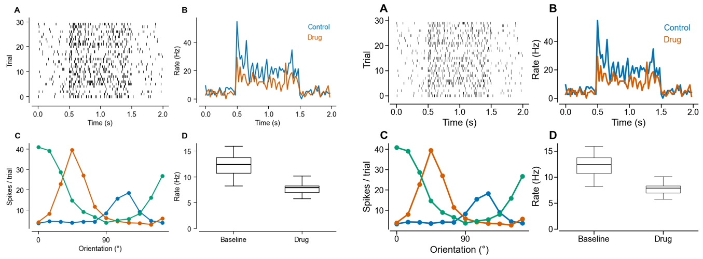

# Publication-quality figures with matplotlib, for neuroscientists

A **90-minute**, hands-on tutorial for PhD students who are new to Python. Students change settings at the top of a
cell and re-run it, then write the ones they like into **their own matplotlib style file**. After that, every future plot
looks like a journal figure with one line:

```python
plt.style.use("neuro")                   # paper figure, one journal column
plt.style.use(["neuro", "neuro-talk"])   # the same figure, sized for slides
```

No package and nothing to install: a style is a plain text file, copied once into matplotlib's style folder.



## Schedule

| Notebook | Time | What happens | 🎛 Try it |
|---|---|---|---|
| `01_first_plot` | 15 min | just enough NumPy, `fig, ax`, the names of the parts of a figure | dress up a plot: box, ticks, font size, line width |
| `02_style_files` | 20 min | rcParams, **make figures at final size**, write `1_basics.mplstyle` | try settings; watch fonts shrink as the figure grows |
| `03_neuroscience_plots` | 30 min | raster, PSTH, tuning ± SEM, calcium heatmap, paired data, box plots, colors → `2_plots_color.mplstyle` | PSTH bin width; heatmap colormap / clipping / square pixels |
| `04_paper_figure` | 25 min | layout, panel letters, export, polish → `3_paper.mplstyle`, merge into `neuro` + `neuro-talk` | layout engine; type your own panel layout; polish switches; paper ↔ talk |
| `05_toolbox` | optional | recipes for later: scale bars, LFP spectra, diverging/cyclic colormaps, color-blindness check, dark/boxed styles, style typo checker, editable-PDF check, `rasterized=True` | – |

Notebooks 1–3 use one small plot at a time. The only multi-panel figure is a 2 × 2 at the end of notebook 4.
Code cells are short (the longest are the style files themselves). Each notebook ends with one optional
exercise for fast students.

`neurodata.py` generates all the data (LIF neuron, Poisson rasters, V1 tuning, GCaMP-like imaging, LFP,
a paired drug experiment), so nobody gets stuck loading files.

| matplotlib default | after notebook 2 |
|---|---|
|  |  |

## Setup

```bash
conda env create -f environment.yml
conda activate plotcourse
jupyter lab
```

Needs matplotlib ≥ 3.7. Run the notebooks in order: each uses the style
parts written by the previous ones. Ask students to set up the environment **before** the session.

## For instructors

* `reference/styles/`: the finished style files you get by running all notebooks unchanged
  (`plt.style.use("reference/styles/neuro.mplstyle")` to try them).
* `reference/previews/`: before/after, paper vs talk, and all toolbox recipes (`toolbox.png`).
* `images/anatomy.png` is the labelled "parts of a figure" picture used in notebook 1.
* Running late? Skip the exercises, and in notebook 4 just run the cells without discussing each one.

### TODO
- [ ] try the timing on a test audience
- [ ] check the journal column widths against current author guidelines
