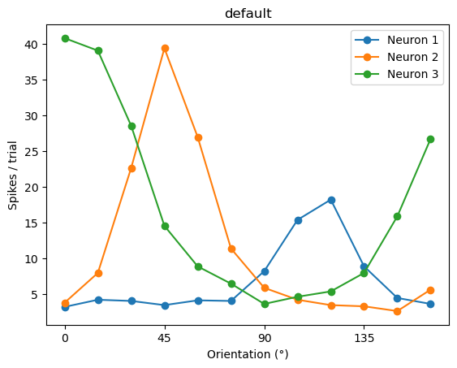
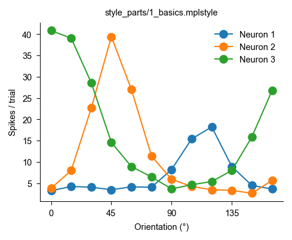

# Publication-quality figures with matplotlib, for neuroscientists

A **90-minute**, hands-on tutorial for PhD students who are new to Python. Students style plots by hand, then
write the settings they like into **their own matplotlib style file**, `my_style.mplstyle`. After that, every future
plot looks like a journal figure with one line:

```python
plt.style.use("my_style.mplstyle")
```

No package and nothing to install: a style is a plain text file.

## Schedule

| Notebook | Time | What happens | 🎛 Try it |
|---|---|---|---|
| `01_first_plot` | 15 min | just enough NumPy, `fig, ax`, the names of the parts of a figure | dress up a plot: box, ticks, font size, line width |
| `02_style_files` | 20 min | style three plots by hand, create `my_style.mplstyle` with one cell, then edit it and re-run | marker, line width, ticks, frame, colors; then the same in the file |
| `03_neuroscience_plots` | 45 min | with `my_style.mplstyle`: membrane potential, raster, PSTH, tuning ± SEM, calcium heatmap, LFP spectrum, paired data, box plots; ✏️ an exercise after each, ending with your own 2 × 2 figure saved as PDF | PSTH bin width; heatmap colormap / clipping / square pixels |
| `05_toolbox` | optional | recipes for later: scale bars, LFP spectra, diverging/cyclic colormaps, color-blindness check, dark/boxed styles, using your style by name, style typo checker, editable-PDF check, `rasterized=True` | – |

Code cells are short (the longest is the style file itself). For students new to Python,
`03_neuroscience_plots_beginner` has the same plots, but each exercise is a nearly finished cell with a few
`FILL_IN` gaps, a hint and a folded-away answer. Elsewhere exercise cells are empty; `01_first_plot_with_solutions`
and `03_neuroscience_plots_with_solutions` have the answers.

`neurodata.py` generates all the data (LIF neuron, Poisson rasters, V1 tuning, GCaMP-like imaging, LFP,
a paired drug experiment), so nobody gets stuck loading files.

| matplotlib default | after notebook 2 |
|---|---|
|  |  |

## Setup

```bash
conda env create -f environment.yml
conda activate plotcourse
jupyter lab
```

Needs matplotlib ≥ 3.7. Run the notebooks in order: notebook 2 creates `my_style.mplstyle`, and
notebooks 3 and 5 use it.
